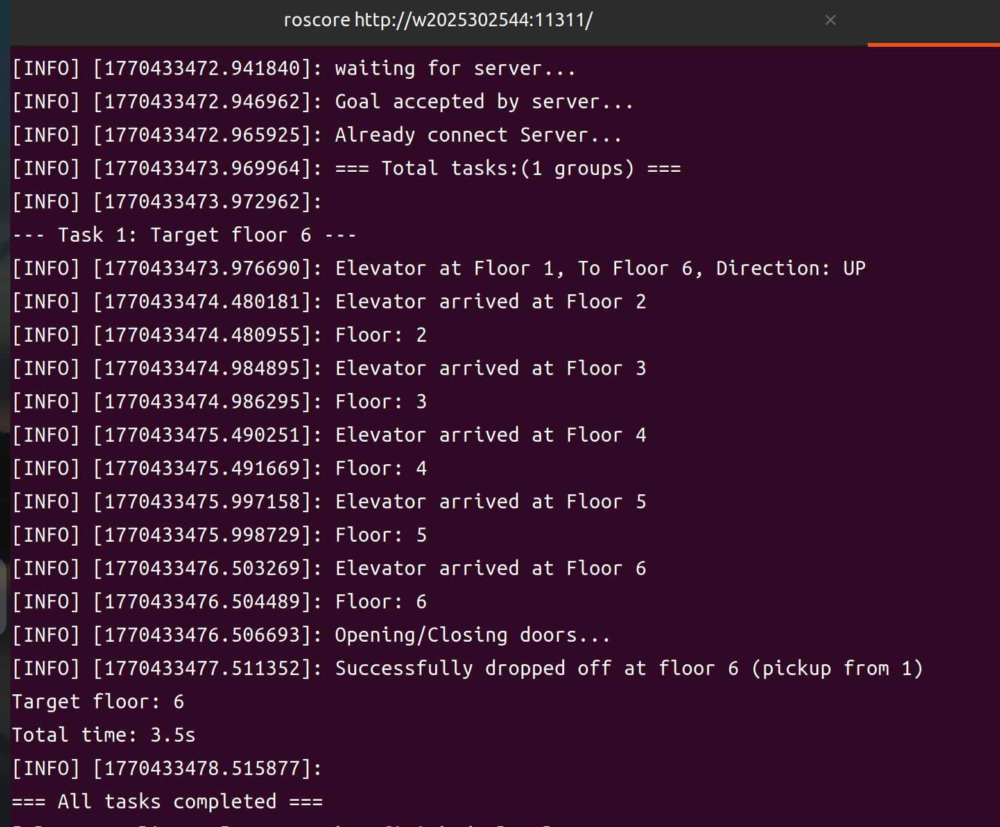

<h1 align="center">ROS Action</h1>
<p align="center">
  
  
  
  
</p>
<hr>

## 项目列表
本仓库是一个 catkin 工作空间，包含 3 个功能包：

```
task2/
├── src/
│   ├── solve_t1/                 # Task 1：单次电梯调度（已知起点+终点）
│   │   ├── action/ELEV.action
│   │   ├── scripts/client.py
│   │   ├── scripts/server.py
│   │   └── launch/elevator.launch
│   ├── solve_t2/                 # Task 2：SCAN 多请求调度（已知起点+终点，运行中插入新请求）
│   │   ├── action/ELEV.action
│   │   ├── scripts/client.py
│   │   ├── scripts/server.py
│   │   └── launch/elevator.launch
│   └── solve_t3/                 # Task 3：目的地未知（已知起点+方向，上电梯后才生成目标）
│       ├── action/ELEV.action
│       ├── scripts/client.py
│       ├── scripts/server.py
│       └── launch/elevator.launch
└── action_learn.md
```

> 注意：三个任务的 Action 名称都使用 `ELEV_action`，一次只运行一个任务（避免多个 server 抢同一个 action 名）。

## 调度系统基本参数

- 楼层范围：1 ~ 10
- 电梯运行耗时：0.5s / 层（server 侧用 `sleep(0.5)` 模拟）
- 开关门耗时：1.0s（T1/T2 在 server 侧模拟；T3 在 client 的到站处理里模拟）
- 乘客状态（T2/T3）：`waiting`（等待上电梯）→ `on`（已上电梯）→ `off`（已送达）
- SCAN 的核心数据结构：
  - `stops`：需要停靠的楼层集合（包含“上电梯楼层”和“下电梯楼层”）
  - `passengers`：请求列表（记录乘客起点/终点/状态等）

  
### T1：单次电梯调度（solve_t1）

**功能描述**
- 模拟 1 次接送过程
- 已知信息：乘客起始楼层 `current_id` 与目标楼层 `target_id`
- 要求：服务端在运行过程中持续反馈 `now_floor`

**实现的功能**
- client：负责发起一次请求 + 打印结果
- server：负责逐层运行 + 逐层反馈 + 到站结束

**电梯运行逻辑**
- server 收到 Goal 后，在 `execute_callback(goal)` 中：
  - 计算方向与步长（+1 或 -1）
  - 用 `while current_floor != target_floor` 逐层模拟
  - 每走一层发布一次 `Feedback.now_floor`
  - 最后发布 `Result.success`

**函数解释**
- server：`ELEVActionServer.execute_callback()` 是执行入口，内部调用 `publish_feedback()` 与 `set_succeeded()`
- client：发送当前楼层和目标楼层
  - `send_goal()`
  - `feedback_callback()` 对应接收 server 的 `publish_feedback()`
  - `done_callback()` 对应接收 server 的 `set_succeeded(result)`

**Action 接口**
- 文件：`src/solve_t1/action/ELEV.action`
- Goal：`int32 current_id`，`int32 target_id`
- Feedback：`int32 now_floor`
- Result：`bool success`

**运行方式**

```bash
source /opt/ros/noetic/setup.bash
cd /home/wly/task2
source devel/setup.bash
roslaunch solve_t1 elevator.launch
```
或分终端运行：

```bash
python3 src/solve_t1/scripts/server.py
python3 src/solve_t1/scripts/client.py
```

运行结果：


---

### T2：SCAN 多请求调度（solve_t2）

**功能描述**
- 处理多条乘客请求，运行过程中随机插入新请求
- 调度策略：SCAN（同向优先，到同向无请求再反向）
- 通信：客户端循环多次发送 goal；服务端负责执行，并逐层反馈

**实现的功能**
- client 内实现SCAN算法，负责决定下一次要去哪个停靠楼层
- 新请求产生：在 `run()` 循环中用 `if + random.random() < p` 概率触发 `add_request(1)`

**电梯运行逻辑**
- client：
  - 维护更新 `stops` 与 `passengers`，分别存储停靠站和乘客信息
  - 通过 `get_next_target()` 依据scan算法在当前方向上选择最近停靠点；若同向无停靠点则反向
  - 到站后 `process_floor()` 更新乘客状态，并把下电梯楼层移除
- server：
  - 每次 Goal 都是“从 current_id 去 target_id”，用 `while` 逐层 `publish_feedback()`

**函数解释**
- `SCAN.add_request(cnt)`：生成乘客请求，并把上电梯楼层加入 `stops`
- `SCAN.get_next_target()`：SCAN（同向优先、无同向则反向）
- `SCAN.run()`：主循环（插入请求 → 选下一站 → send_goal → 等待结果 → 到站处理）
- `SCAN.process_floor(floor)`：完成上下客状态更新与人数统计

**Action 接口**
- 文件：`src/solve_t2/action/ELEV.action`
- Goal：`int32 current_id`，`int32 target_id`
- Feedback：`int32 now_floor`
- Result：`bool success`

**运行方式**

```bash
source /opt/ros/noetic/setup.bash
cd /home/wly/task2
source devel/setup.bash
roslaunch solve_t2 elevator.launch
```

或分终端运行：

```bash
python3 src/solve_t2/scripts/server.py
python3 src/solve_t2/scripts/client.py
```
运行结果： 


---

### T3：目的地未知（solve_t3）

**功能描述**
- 乘客请求发出时只知道在哪一层和方向；上电梯后才生成目的楼层
- 一次 goal 只走 1 层，长距离由客户端多次调用组合完成。

**实现的功能**
- 请求生成时不含目标楼层：`target=None`，仅记录 `start` 与 `req_dir`（方向）
- 电梯到达乘客起始楼层并上客时（PICKUP），在 `process_floor()` 内根据方向随机生成 `target`

**电梯运行逻辑**
- Goal 只有 `direction`，server 不知道终点，所以无法在 server 内写while 到目标
- client：
  - 仍用 `get_next_target()` 决定下一停靠楼层，但每次只向 server 下发走一步的 Goal（UP/DOWN），循环多次直到到达下一站
  - 到站后调用 `process_floor()`（上客时生成 target，并把 target 加入 `stops`）
- server：
  - `execute_callback(goal)` 内只计算 `end_floor = current_id ± 1`
  - `set_succeeded(result)` 结束本次 step

**函数解释**
- client：
  - `add_request()`：随机生成 `start + req_dir`
  - `process_floor()`：在 PICKUP 分支写入 `p['target']`
  - `run()`：循环发送goal，并用 `get_result().success` 控制是否更新 `current_floor`
- server：`execute_callback()` 负责校验与单步移动，并用 `publish_feedback()` 把 `now_floor` 发给客户端

**Action 接口**
- 文件：`src/solve_t3/action/ELEV.action`
- Goal：`int32 current_id`，`string direction`
- Feedback：`int32 now_floor`
- Result：`bool success`

**运行方式**

```bash
source /opt/ros/noetic/setup.bash
cd /home/wly/task2
source devel/setup.bash
roslaunch solve_t3 elevator.launch
```

或分终端运行：

```bash
python3 src/solve_t3/scripts/server.py
python3 src/solve_t3/scripts/client.py
```
运行结果：

---

**三次运行视频**：[🎬 点击观看演示视频](task2.webm)

---

**尚可改进的地方**

  - 在 SCAN 基础上补充 LOOK算法实现，并对比两者在不同请求分布下的总运行层数/等待时间；
  - 乘客数量默认是一人，可以拓展为同一楼层多乘客、电梯容量限制等；
  - t2t3运行时间没有计算出来，后续可以计算出来并对比scan和look算法的效率；
 

**学习心得 💡**
通过本次任务，我对 Action 通信的理解更清晰，明确了 Action 的格式（Goal、Feedback、Result）以及 `publish_feedback()`/`set_succeeded()` 分别触发 client 回调的关系；
其中遇到了很多问题，例如对Action 状态是否 SUCCEEDED和result.success这两层语义区分不清等，最终通过询问AI和上网查找解决。在这个过程中，再一次深化了问题分析和逻辑切割的理解，通过分块写不同的函数 `add_request/get_next_target/run/process_floor`，调试更加容易了；此外，还进一步熟悉了 `.launch`、`CMakeLists.txt`、`package.xml` 文件格式。

> 感谢这次考核让我系统性地学习并掌握了 ROS Action通信机制以及电梯调度问题相关算法，为后续学习打下了基础！

<hr>
<p align="center">
  
  
</p>

